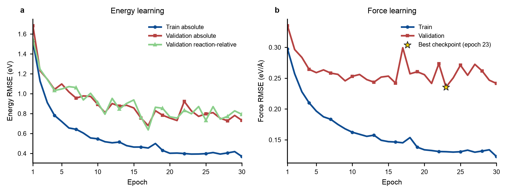
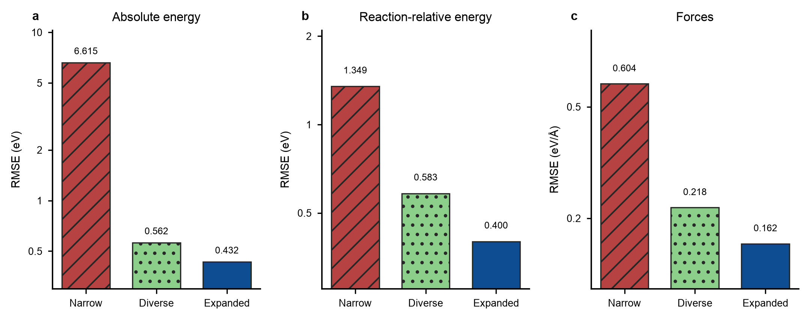

# Mini Transition1x PaiNN Reproduction

A small, learning-oriented reproduction of a reactive machine-learning interatomic
potential workflow using subsets of
[Transition1x](https://doi.org/10.1038/s41597-022-01870-w) and the
[PaiNN](https://proceedings.mlr.press/v139/schutt21a.html) architecture. The project
studies how reaction coverage and training-set size affect energy and force errors
on one fixed set of reactions.

## Motivation

Although I had some background in theoretical and quantum chemistry, I had not
systematically studied machine-learning interatomic potentials (MLIPs). The
Transition1x dataset paper and the PaiNN paper provided learning material from two
complementary directions: reactive data and equivariant neural networks. I therefore
attempted to reproduce a compact learning workflow.

## What this repository contains

- structural and split-integrity checks for the full Transition1x HDF5 file;
- small lessons on energy–force automatic differentiation, rigid-motion symmetry,
  message passing, and a minimal PaiNN-style scalar–vector model;
- a learning test using SchNetPack's official PaiNN implementation on a known
  synthetic potential;
- three different mini-Transition1x dataset subsets;
- a compact energy-and-force training loop using SchNetPack PaiNN;
- tests, results, and a report.

## Scientific question

For an energy model $E_\theta(\mathbf Z,\mathbf R)$, conservative forces are
obtained from

$$
\mathbf F_i^\theta=-\frac{\partial E_\theta}{\partial \mathbf R_i}
$$

This relation guarantees mathematical consistency between the predicted energy and
force, but it does not guarantee that either quantity is close to its reference
value. The experiment asks a narrower question:

> How do reaction coverage and training-set size affect the energy and force errors
> of a compact PaiNN model on held-out mini-Transition1x reactions?

Three training strategies were compared:

| Training strategy | Configurations | Formulas | Reactions |
|---|---:|---:|---:|
| Low-coverage | 2,910 | 4 | 12 |
| Diverse, approximately equal size | 3,060 | 155 | 306 |
| Expanded diverse | 10,690 | 155 | 1,069 |

Every checkpoint was evaluated on the same fixed test split containing 150
configurations, 8 formulas, and 15 reactions. Formula-level splitting keeps the test
formulas separate from the training formulas.

## Main results

| Training strategy | Absolute energy RMSE (eV) | Reaction-relative energy RMSE (eV) | Force RMSE (eV/Å) |
|---|---:|---:|---:|
| Low-coverage | 6.615 | 1.349 | 0.604 |
| Diverse, approximately equal size | 0.562 | 0.583 | 0.218 |
| Expanded diverse | 0.432 | 0.400 | 0.162 |

At nearly equal configuration count, replacing the low-coverage training subset with
a more chemically diverse subset reduced all three fixed-test errors. Increasing the
number of sampled reactions and configurations within the diverse set reduced them
further in this run. For this compact model and fixed mini test split, broader
reaction and formula coverage helped reduce the test errors.



The expanded run reached its lowest validation force RMSE at epoch 23.



The complete result tables are stored in [`results/`](results/), and the longer
scientific discussion is available in [`report/main.pdf`](report/main.pdf).

## Environment

The reviewed local environment used:

- macOS on ARM64;
- Python 3.14.3;
- PyTorch 2.15.0;
- SchNetPack 2.3.0;
- ASE 3.29.0;
- h5py 3.16.0;
- NumPy 2.5.5.

Create an isolated environment and install the reviewed dependencies:

```bash
python3 -m venv .venv
source .venv/bin/activate
python -m pip install -r requirements-dev.txt
python scripts/check_environment.py
pytest -q
```

The current test suite contains 47 tests. The HDF5-dependent provenance test is
skipped when the downloaded data are not present.

## Data preparation

The Transition1x HDF5 file is not included in this repository. Obtain file `36035789`
from the official Transition1x Figshare record and place it at
`data/transition1x.h5`. The direct download is:

```text
https://ndownloader.figshare.com/files/36035789
```

Check the full file before constructing subsets:

```bash
python src/inspect_t1x.py data/transition1x.h5
```

Build the three local mini datasets:

```bash
# Low-coverage subset used for the first training strategy
python src/build_mini_t1x.py \
  data/transition1x.h5 data/mini_transition1x.h5

# Diverse subset with a similar number of training configurations
python src/build_diverse_mini_t1x.py \
  data/transition1x.h5 data/mini_diverse_equal_transition1x.h5 \
  --reactions-per-formula 2 --frames-per-reaction 10 --seed 7

# Expanded diverse subset
python src/build_diverse_mini_t1x.py \
  data/transition1x.h5 data/mini_expanded_transition1x.h5 \
  --reactions-per-formula 8 --frames-per-reaction 10 --seed 7
```

## Training

The compact model uses 64 features, three PaiNN interaction blocks, a 5 Å cutoff,
batch size 32, learning rate $10^{-3}$, 30 epochs, and seed 7. Energy and force
losses are combined as

$$
\mathcal L=0.01\\mathcal L_E+0.99\\mathcal L_F.
$$

The numerical weights are a teaching choice, not universal physical constants.
Example commands for the controlled comparison are:

```bash
# Low-coverage training data; validation and test come from the fixed diverse file
python src/train_mini_t1x_painn.py data/mini_transition1x.h5 \
  --eval-hdf5 data/mini_diverse_equal_transition1x.h5 \
  --epochs 30 --seed 7 --device cpu \
  --checkpoint checkpoints/mini_painn.pt \
  --metrics-json results/narrow_training.json

# Diverse, approximately equal-size training data
python src/train_mini_t1x_painn.py data/mini_diverse_equal_transition1x.h5 \
  --eval-hdf5 data/mini_diverse_equal_transition1x.h5 \
  --epochs 30 --seed 7 --device cpu \
  --checkpoint checkpoints/diverse_equal_mini_painn.pt \
  --metrics-json results/diverse_equal_training.json

# Expanded diverse training data
python src/train_mini_t1x_painn.py data/mini_expanded_transition1x.h5 \
  --eval-hdf5 data/mini_diverse_equal_transition1x.h5 \
  --epochs 30 --seed 7 --device cpu \
  --checkpoint checkpoints/expanded_mini_painn_complete.pt \
  --metrics-json results/expanded_training_complete.json
```

Exact floating-point results can vary with package versions, hardware, and backend
even when the sampling and training seed are fixed.

## Learning test

Run the official-PaiNN learning test on a known synthetic potential:

```bash
python src/official_painn_learning.py
```

## Repository map

```text
src/          data inspection, subset construction, lessons, and PaiNN training
scripts/      environment checks and figure generation
tests/        automated schema, physics, symmetry, sampling, and plotting tests
results/      compact CSV/JSON source data for the reported figures
figures/      reviewed PDF, PNG, and SVG figures
report/       LaTeX source, bibliography, build instructions, and compiled report
docs/         project scope and publication notes
```

## References

- M. Schreiner, O. Winther, and S. Olsson, “Transition1x: A dataset for building
  generalizable reactive machine learning potentials,” *Scientific Data* **9**, 779
  (2022). [https://doi.org/10.1038/s41597-022-01870-w](https://doi.org/10.1038/s41597-022-01870-w)
- K. T. Schütt, O. T. Unke, and M. Gastegger, “Equivariant message passing for the
  prediction of tensorial properties and molecular spectra,” *ICML 2021*.
  [https://proceedings.mlr.press/v139/schutt21a.html](https://proceedings.mlr.press/v139/schutt21a.html)
- K. T. Schütt *et al.*, “SchNetPack 2.0: A neural network toolbox for atomistic
  machine learning,” *J. Chem. Phys.* **158**, 144801 (2023).
  [https://doi.org/10.1063/5.0138367](https://doi.org/10.1063/5.0138367)

## License

The original code and documentation in this repository are released under the
[MIT License](LICENSE). Transition1x data are not redistributed by this repository;
downloaded data remain subject to the terms of their original provider.

